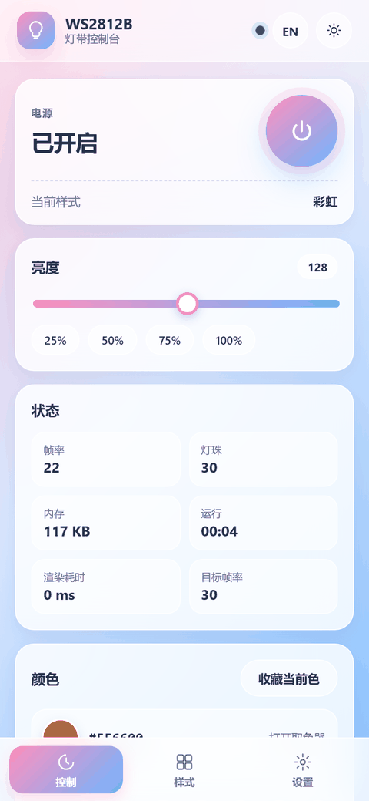
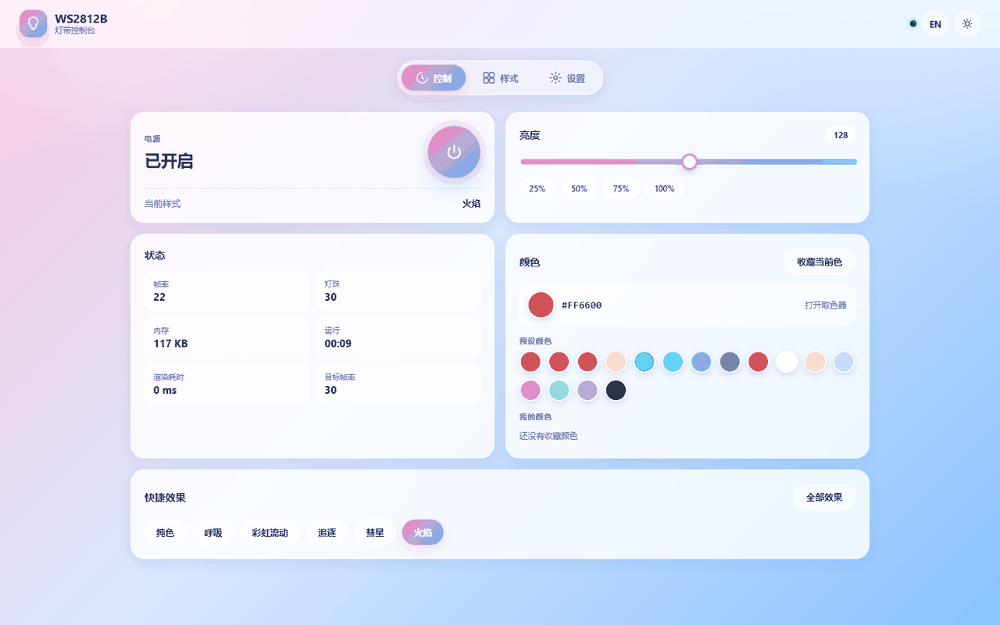
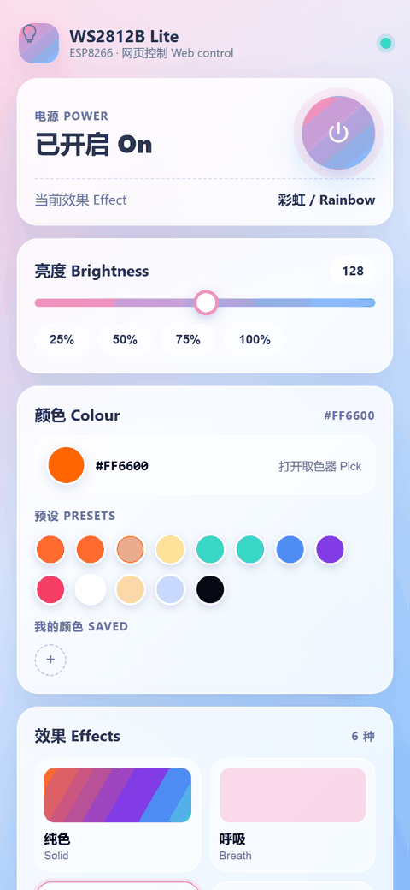

# ESP Web WS2812B (MicroPython)

基于 MicroPython 的 ESP32 网页控制 WS2812B 灯带项目：手机或电脑连上设备的 WiFi，
打开浏览器即可控制颜色、亮度、15 种内置效果，并保存/自定义样式。
An open-source WS2812B controller for ESP32 / ESP32-C3 / ESP32-S3 running
MicroPython. Connect to its WiFi AP and control the strip from any browser —
no app required.

作者 / Author: **洋洋柚**（B站/抖音 **洋洋柚Y**）

- GitHub: <https://github.com/YangYangyou-Zhang/esp_web_ws2812b_micropython>
- Gitee: <https://gitee.com/zhangyangyangyou/esp_web_ws2812b_micropython>
- 视频教程 / Video: <https://www.bilibili.com/video/BV1zz5zzFEbM>
- 许可 / License: **CC BY-NC-SA 4.0**（署名—非商业—相同方式共享；**禁止商用，含售卖套件**；见 [LICENSE](LICENSE) 与 [NOTICE.md](NOTICE.md)）。

### 版本选择 / Versions

| 版本 | 芯片 | 源码目录 | 功能 | 安装 |
|---|---|---|---|---|
| 完整版 Full | ESP32 / C3 / S3 | `firmware/esp32/` | 15 效果、样式系统、Python 自定义、强制门户 | `python tools/install.py COM5` |
| ESP8266 Lite | ESP8266 | `firmware/esp8266_lite/` | 6 效果、取色器、强制门户 | `python tools/install.py COM5 --lite --reset` |
| Legacy | ESP8266 / ESP32 | `legacy/` | 旧版单文件脚本 | 手动上传为 `main.py` |

单文件版：`python tools/build_single.py` → `dist/main_single.py`。详细说明见 [VERSIONS.md](VERSIONS.md)。

<p align="center">
  
  
</p>

---

## 中文

### 功能

- **自适应界面**：移动端底部导航、桌面端胶囊导航，同一套 UI 在手机和电脑上布局一致。
- **内置取色器**：色相/饱和度/明度面板 + HEX/RGB 输入，16 个预设色，支持收藏自定义颜色。
- **15 种内置效果**：纯色、渐变、呼吸、彩虹、彩虹流动、追逐、剧院追逐、彗星、星闪、随机闪烁、火焰、烛光、擦除、扫描、频闪。
- **实时调参**：速度、颜色、密度、拖尾等参数由固件下发，网页自动生成控件，拖动即生效。
- **样式系统**：把当前效果保存到 flash；支持导入/导出 JSON；支持 Python 自定义效果。
- **开机样式**：任意样式可设为开机默认，包含参数与亮度，断电不丢失。
- **LED 数量/引脚可配**：网页修改 LED 数并立即生效；引脚、AP 名称修改后重启生效。
- **中英切换**、深/浅主题、离线提示、设备状态（帧率/内存/运行时间）。
- **非阻塞动画引擎**：动画与网页服务同一线程但互不卡死，开灯时网页仍然跟手。
- **断网可用**：UI 不依赖任何 CDN 或外部字体。
- **连接自动弹出控制页**：内置 DNS 劫持 + 302 的强制门户（Captive Portal）。

### 硬件与接线

- 完整版：ESP32 / ESP32-C3 / ESP32-S3，4 MB flash。
- **ESP8266**：使用极简版 [`firmware/esp8266_lite/`](firmware/esp8266_lite)（只有 `main.py` + `lite.html`
  两个文件，6 个效果）。库存 ESP8266 在 AP 模式下只有约 30 KB 堆，放不下完整版。
- 固件：MicroPython 1.19+（ESP32-C3 建议最新版）。
- 灯带：WS2812B / SK6812（RGB 顺序），5V 供电。
- 接线：灯带 `5V` → 电源 5V，`GND` → 电源 GND，`DIN` → 开发板 GPIO2（默认）。
- **必须共地**：开发板 GND 与灯带电源 GND 连在一起。
- 灯带较长时请从两端注入 5V，避免末端压降导致偏色。
- 不要用 GPIO9（ESP32-C3 的 BOOT 脚），会导致无法正常启动。

### 安装（多文件，推荐）

1. 给开发板刷入 MicroPython 固件，用 Thonny 能连上 REPL。
2. 源码位于 `firmware/esp32/`；把以下文件上传到设备根目录：

   ```
   main.py
   settings.py
   effects.py
   stylelib.py
   engine.py
   httpd.py
   www/           (index.html, app.css, app.js)
   styles/        (示例 JSON / Python 样式，可选)
   ```

3. 用 mpremote 一条命令完成（推荐）：

   ```bash
   pip install mpremote
   python tools/install.py COM5        # Windows
   python tools/install.py /dev/ttyACM0  # Linux / macOS
   ```

   或手动：

   ```bash
   mpremote connect COM5 fs cp firmware/esp32/main.py firmware/esp32/settings.py firmware/esp32/effects.py firmware/esp32/stylelib.py firmware/esp32/engine.py firmware/esp32/httpd.py :
   mpremote connect COM5 fs mkdir :www
   mpremote connect COM5 fs cp firmware/esp32/www/index.html :www/index.html
   mpremote connect COM5 fs cp firmware/esp32/www/app.css :www/app.css
   mpremote connect COM5 fs cp firmware/esp32/www/app.js :www/app.js
   mpremote connect COM5 fs mkdir :styles
   ```

4. 按 RST 重启。

### 安装（单文件）

```bash
python tools/build_single.py
```

生成 `dist/main_single.py`，把它上传为设备的 `main.py` 即可。首次启动会把网页和示例样式
写入 flash。仅建议 ESP32 系列使用；ESP8266 请用 [`firmware/esp8266_lite/`](firmware/esp8266_lite)。

### ESP8266 Lite

ESP8266 用极简版：[`firmware/esp8266_lite/`](firmware/esp8266_lite) — 只需上传 `main.py` 和 `lite.html`。
保留 6 个效果、亮度/电源、内置取色器、LED 数/引脚/开机效果，配置存 `lite.cfg`。
没有 JSON 样式、多灯带和自定义 Python 效果。详见
[firmware/esp8266_lite/README.md](firmware/esp8266_lite/README.md)。

<p align="center">
  
</p>

### 首次使用

1. 上电后设备开启热点：SSID `ESP_WS2812B_BY_YYY`，密码 `12345678`。
2. 手机/电脑连接该热点；**安卓手机请关闭移动数据**（否则可能仍走流量）。
3. 大多数设备会自动弹出「登录网络 / 需要登录」页面，点开就是控制页；没弹就手动打开
   <http://192.168.4.1>。
4. 默认开机样式为「彩虹」，30 颗灯、GPIO2、亮度 128。

### 连接后自动弹出控制页（强制门户）

固件内置了 Captive Portal：

- AP 的 DHCP 会把 DNS 指向 `192.168.4.1`；固件在 UDP 53 上把所有域名都解析到设备 IP。
- 手机/电脑连上后会探测 `connectivitycheck.gstatic.com`、`captive.apple.com`、
  `msftconnecttest.com`、`connect.rom.miui.com` 等地址；HTTP 服务器发现 `Host`
  不是 `192.168.4.1`，就返回 `302 Location: http://192.168.4.1/`。
- 系统判定“此网络需要登录”，自动弹出登录页/通知，打开即是控制页。

注意：

- 自动弹出是操作系统的行为，**不保证所有手机/系统都会弹**。安卓有移动数据时可能不弹；
  iOS 可能提示“无互联网连接”，选择继续使用即可；部分定制 ROM 需手动开浏览器。
- 连上 AP 后所有域名都会解析到设备（本来也没有外网），属正常现象。
- HTTPS 探测会失败，系统会回退到 HTTP 探测；控制页本身是 HTTP。
- 如果 DHCP 没把 DNS 指向设备（非默认固件），需要手动把 DNS 设为 `192.168.4.1`。
- 不想用这个功能：注释 [httpd.py](httpd.py) `start()` 里的 `self._start_portal()`，
  重新上传即可；DNS 端口监听失败时也会自动跳过，不影响正常使用。

### 页面说明

- **控制**：开关、亮度（含 25/50/75/100% 快捷键）、颜色（内置取色器/预设/收藏）、快捷效果、状态。
- **样式**：15 个内置效果卡片；点选后在手机端弹出参数面板，桌面端显示在下方；
  可实时调参、存为样式、设为开机样式。下方是「我的样式」，支持应用/开机/导出/编辑/删除。
- **设置**：LED 数、引脚、帧率、颜色顺序、开机模式/样式/亮度、AP 名称密码、设备信息、日志、重启。

### 配置

首次启动会自动创建 `data/settings.json`。也可以先把 [`firmware/esp32/configs/`](firmware/esp32/configs) 里的示例
复制成 `data/settings.json` 再上传：

```json
{
  "schema": 1,
  "wifi": {"ssid": "ESP_WS2812B_BY_YYY", "password": "12345678"},
  "hardware": {"pins": [2], "leds": 30},
  "render": {"fps": 30, "brightness": 128, "max_leds": 1024, "color_order": "RGB"},
  "boot": {"mode": "preset", "style": "builtin:rainbow",
           "params": {}, "brightness": 128, "power": true}
}
```

- `hardware.pins`：支持多条灯带（最多 8 条），所有灯带同步显示同一效果。
- `color_order`：默认 `RGB`；如果红绿互换，改成 `GRB`（多数 WS2812B 是 GRB 时序）。
- 修改引脚/AP 需要重启；修改 LED 数立即生效。
- 恢复出厂：删除 `data/settings.json` 后重启。

### 性能参考（实测会因固件版本/布线不同而变化）

WS2812B 每颗灯约 30 µs 传输时间，帧率还受 Python 渲染和 WiFi 影响：

ESP32-C3（160 MHz，1 条灯带，彩虹效果）实测：

| 灯数 | 实测帧率 | 单帧耗时 |
|---|---|---|
| 30 | 30 | 5–7 ms |
| 100 | 30 | ~32 ms |
| 300 | 15 | ~70 ms |

普通 ESP32（WROOM，4 MB，固件自动尝试 240 MHz）实测：

| 灯数 | 实测帧率 | 单帧耗时 | 备注 |
|---|---|---|---|
| 30 | 29–30 | 13–22 ms | 推荐 |
| 100 | 22 | ~51 ms | 堆已经非常紧 |
| 300 | 7 | ~156 ms | 不建议 |

普通 ESP32 建议控制在 30–60 颗；100 颗以上优先用 C3/S3。不同模块的 flash、供电和
MicroPython 构建会影响结果。30 FPS 需要单帧 ≤33 ms；要更多灯就降低帧率，
或用 `solid`/`breath` 这类用 `fill()` 的效果（更快）。
状态卡会显示实测 FPS 与单帧耗时；旧版示例的「3 条 × 512 灯」在任何 ESP 上都不现实。

### 自定义样式

- 声明式 JSON：见 [docs/STYLE_FORMAT.md](docs/STYLE_FORMAT.md)，机器可读 Schema 为
  [firmware/esp32/style.schema.json](firmware/esp32/style.schema.json)。
- Python 脚本：见 [docs/CUSTOM_EFFECTS.md](docs/CUSTOM_EFFECTS.md)。
- HTTP 接口：见 [docs/API.md](docs/API.md)。
- 给其他 AI 工具的入口：[AGENTS.md](AGENTS.md)。

### 目录结构

```
VERSIONS.md          版本选择与快速开始
firmware/esp32/       完整版源码：main.py、settings.py、engine.py、effects.py、
                      stylelib.py、httpd.py、www/、styles/、configs/、style.schema.json
firmware/esp8266_lite/  ESP8266 极简版（main.py + lite.html）
docs/                样式/API/自定义效果文档与截图
tools/               模拟器、构建、上传、UI 测试、effects.json 生成
LICENSE / NOTICE.md  许可与署名/第三方声明
legacy/              旧版单文件脚本（已弃用，保留供参考）
```

### 开发与测试

```bash
python tools/sim.py                 # 完整版模拟器 → http://127.0.0.1:8000
python tools/sim_lite.py            # ESP8266 lite 模拟器 → http://127.0.0.1:8002
npm install --no-save puppeteer-core
node tools/uitest.js                # 完整版截图与布局检查
node tools/lite_uitest.js           # lite 截图与布局检查
python -m py_compile firmware/esp32/*.py firmware/esp8266_lite/main.py tools/*.py
```

`uitest.js` 默认使用 Windows 的 Edge；可用 `EDGE=/path/to/chrome node tools/uitest.js` 指定其他浏览器。

模拟器用 stub 替换 `machine/neopixel/network/esp32`，运行的是同一套后端与前端代码。

### 常见问题

1. **ESP32-C3 报 `OSError(-258, ESP_ERR_INVALID_ARG)`**：RMT 通道冲突。
   新固件已在 `main.py` 中自动执行 `esp32.RMT.bitstream_channel(0)`；旧版需手动添加。
2. **颜色红绿互换**：把 `render.color_order` 改为 `GRB`（设置页也可选）。
3. **网页打不开**：确认连的是设备热点；安卓关闭移动数据；浏览器访问 `http://192.168.4.1`。
4. **开灯后网页卡住**：旧版才有此问题（呼吸灯死循环）；新版已改为非阻塞引擎。
5. **帧率低/闪烁**：降低 LED 数或帧率；缩短灯带；检查 5V 供电和共地。
6. **自定义效果导致死机**：Python 死循环无法被抢占。重启后在 Thonny 删除
   `/styles/<id>.py` 与 `/styles/<id>.json`，或在 `data/settings.json` 把 `boot.mode` 改为 `off`。
7. **改引脚不生效**：引脚和 AP 设置需要重启。
8. **flash 空间不足**：删除不用的样式文件。
9. **ESP8266 能跑完整版吗**：不能可靠运行。请用 [`firmware/esp8266_lite/`](firmware/esp8266_lite)；
   它只有两个文件、6 个效果，专为 ESP8266 的 ~30 KB 堆设计。ESP32 系列用完整版。

### 许可

本项目原创内容采用 **CC BY-NC-SA 4.0**
（Creative Commons Attribution-NonCommercial-ShareAlike 4.0 International，
署名—非商业性使用—相同方式共享 4.0 国际）。
详见 [LICENSE](LICENSE) 与 [NOTICE.md](NOTICE.md)。

- **允许**：个人 DIY、学习、研究、非商业分享与改编。
- **要求**：署名「洋洋柚（B站/抖音 洋洋柚Y）」并附项目地址；改编版必须以相同许可发布，
  并注明是否做了修改。
- **禁止**：任何商业用途，包括售卖成品、套件（PCB / 散件 / 预烧录固件 /
  组装好的灯带控制器），或以收费方式提供代烧录、代组装、技术支持等服务。
- 商用须事先取得作者书面授权。

旧版脚本位于 [`legacy/`](legacy)，不再维护；同样适用本协议。

---

## English

### Features

- Responsive UI: bottom tabs on phones, pill tabs on desktop; same layout logic everywhere.
- Built-in colour picker: HSV area, hue slider, HEX/RGB inputs, 16 presets and saved colours.
- 15 effects: solid, gradient, breathing, rainbow, rainbow flow, chase, theater chase,
  comet, sparkle, twinkle, fire, candle, wipe, scanner, strobe.
- Live parameter controls generated from firmware metadata.
- Style system: save current look to flash, import/export JSON, custom Python effects.
- Configurable boot style (with parameters and brightness), LED count and pins.
- Chinese/English UI, dark/light theme, device status and logs.
- Non-blocking animation engine; the web UI stays responsive while effects run.
- Fully offline: no CDN, no external fonts.
- Captive portal: the control page pops up automatically after joining the AP.

### Hardware

Full firmware: ESP32 / ESP32-C3 / ESP32-S3 with 4 MB flash, MicroPython 1.19+.
**ESP8266**: use the stripped-down [`firmware/esp8266_lite/`](firmware/esp8266_lite) build
(two files, six effects). Stock ESP8266 has only ~30 KB of free heap in AP mode
and cannot run the full firmware.

### Wiring

Connect strip `5V` and `GND` to a suitable 5V supply and **share ground with the board**.
Connect `DIN` to GPIO2 by default. Avoid GPIO9 on ESP32-C3 (BOOT pin).
For long strips, inject 5V at both ends.

### Install (multi-file, recommended)

From `firmware/esp32/`, upload `main.py`, `settings.py`, `effects.py`, `stylelib.py`, `engine.py`, `httpd.py`, and the `www/` and `styles/` folders. The easiest way:

```bash
pip install mpremote
python tools/install.py COM5          # Windows
python tools/install.py /dev/ttyACM0  # Linux / macOS
```

Reset the board afterwards.

### Install (single file)

```bash
python tools/build_single.py
```

Upload `dist/main_single.py` as `main.py`. Web assets and sample styles are written to
flash on first boot. For the ESP32 family only; ESP8266 uses [`firmware/esp8266_lite/`](firmware/esp8266_lite).

### ESP8266 Lite

Stock ESP8266 uses [`firmware/esp8266_lite/`](firmware/esp8266_lite) — upload `main.py` and `lite.html`.
Six effects, brightness/power, built-in colour picker, LED count/pin/boot settings
stored in `lite.cfg`. No JSON styles, multiple strips or custom Python effects.
See [firmware/esp8266_lite/README.md](firmware/esp8266_lite/README.md).

<p align="center">
  
</p>

### First boot

1. Connect to WiFi `ESP_WS2812B_BY_YYY`, password `12345678`.
2. Turn off mobile data on Android.
3. Most devices show a "Sign in to network" sheet automatically; tap it. Otherwise open
   <http://192.168.4.1> manually.
4. Defaults: rainbow, 30 LEDs, GPIO2, brightness 128.

### Captive portal

The firmware runs a captive portal:

- The AP DHCP server advertises `192.168.4.1` as DNS; the firmware answers every UDP
  DNS query with the device IP.
- OS probes such as `connectivitycheck.gstatic.com`, `captive.apple.com` and
  `msftconnecttest.com` reach the HTTP server with a foreign `Host`; the server replies
  `302 Location: http://192.168.4.1/`.
- The OS marks the network as captive and opens the sign-in page, which is the control UI.

Caveats: automatic popup is OS behaviour and not guaranteed (Android may skip it with
mobile data on; iOS may warn "no internet" — choose to stay connected). Every hostname
resolves to the device while joined (there is no internet anyway). HTTPS probes fail and
fall back to HTTP. To disable, comment out `self._start_portal()` in `httpd.py` `start()`.
If DNS cannot bind, the feature is skipped and normal access still works.

### Configuration

`data/settings.json` is created on first boot. See [`firmware/esp32/configs/`](firmware/esp32/configs) for examples.
Pin and AP changes require a reboot; LED count applies immediately.
`render.color_order` defaults to `RGB`; use `GRB` if red and green are swapped.
To factory reset, delete `data/settings.json` and reboot.

### Performance

Each WS2812B LED takes about 30 µs to transmit. Practical guidance:

Measured on ESP32-C3 (160 MHz, one strip, rainbow):

| LEDs | FPS | Frame time |
|---|---|---|
| 30 | 30 | 5–7 ms |
| 100 | 30 | ~32 ms |
| 300 | 15 | ~70 ms |

Plain ESP32 (WROOM, 4 MB; the firmware raises it to 240 MHz when supported) measured:

| LEDs | FPS | Frame time | Note |
|---|---|---|---|
| 30 | 29–30 | 13–22 ms | recommended |
| 100 | 22 | ~51 ms | heap is very tight |
| 300 | 7 | ~156 ms | not recommended |

Keep plain ESP32 modules at 30–60 LEDs; use C3/S3 for 100+. Flash, power and the
MicroPython build all affect these numbers. The status card shows live FPS.
Three strips of 512 LEDs are not viable on any of these chips.

### Docs

- Declarative styles: [docs/STYLE_FORMAT.md](docs/STYLE_FORMAT.md)
- Python effects: [docs/CUSTOM_EFFECTS.md](docs/CUSTOM_EFFECTS.md)
- HTTP API: [docs/API.md](docs/API.md)
- AI agent entry point: [AGENTS.md](AGENTS.md)

### Development

```bash
python tools/sim.py       # full firmware simulator on http://127.0.0.1:8000
python tools/sim_lite.py  # ESP8266 lite simulator on http://127.0.0.1:8002
npm install --no-save puppeteer-core
node tools/uitest.js      # full UI screenshots and layout checks
node tools/lite_uitest.js # lite UI screenshots and layout checks
```

`uitest.js` uses Edge on Windows by default; override with
`EDGE=/path/to/chrome node tools/uitest.js`.

The simulator stubs `machine`, `neopixel`, `network` and `esp32`, and runs the same
firmware/web code as the device.

### License

Original work is licensed under **CC BY-NC-SA 4.0**
(Attribution-NonCommercial-ShareAlike 4.0 International).
See [LICENSE](LICENSE) and [NOTICE.md](NOTICE.md).

- Allowed: personal DIY, study, research and non-commercial sharing/adaptation.
- Required: credit "洋洋柚 (Bilibili/Douyin: 洋洋柚Y)" with a link to the project;
  share adaptations under the same license; indicate whether changes were made.
- Not allowed: any commercial use, including selling finished products or kits
  (PCBs, parts, pre-flashed firmware, assembled controllers) or charging for
  flashing, assembly or support.
- Commercial use requires prior written permission from the author.

The original single-file scripts in [`legacy/`](legacy) are covered by the same license.
